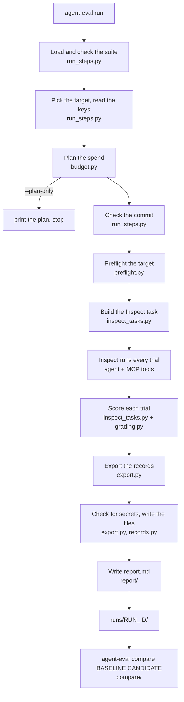

# How agent-eval-harness works

A plain-English guide to the code. For the results and the method, see the
[README](../README.md); for why it's built this way, the
[decision records](planning/phase-5-architecture-decisions.md).

## What it is

The harness measures an *agent setup*: a model, a system prompt and an MCP
server's tools. It runs the setup on a fixed set of tasks several times,
grades every attempt with plain code (no model judges it), and writes the
results as files you can commit. Then it compares two runs and says, with
an exit code CI can use, whether the second one is worse by more than
chance. Running the agent is done by Inspect AI; the harness adds the
grading, the records and the regression gate.

## The flow of one `agent-eval run`

A run goes through these steps, in this order. Nothing is spent before
step 8, and `--plan-only` stops at step 4.



1. **Load the suite.** `agent_eval/cli/run_steps.py: load_suite_or_exit`
   calls `agent_eval/suites.py: load_suite`, which reads the suite's YAML
   and refuses anything it couldn't grade (`validate_suite`). `--tasks`
   picks a few task ids for a small run.
2. **Pick the target and read the keys.**
   `agent_eval/cli/run_steps.py: choose_target` looks the MCP server up in
   `agent_eval/targets.py: TARGETS`. `read_env` and `check_keys` read the
   `.env` file and stop early if a key is missing. `secrets_to_redact`
   remembers every key's value, so step 10 can check none of them ended up
   in the records.
3. **Plan the spend.** `agent_eval/cli/run_steps.py: plan_spend` looks the
   model's price up in `prices.yaml` (`agent_eval/budget.py: price_for`) and
   estimates the cost from earlier runs of the same suite and model
   (`measured_tokens_per_trial`). `agent_eval/budget.py: plan` refuses a
   run whose estimate is over `--budget`, and splits the budget into a
   per-trial cap.
4. **Stop here with `--plan-only`.** `print_plan` prints the trial count,
   the estimate and the budget. Nothing has been spent.
5. **Check the commit.** `agent_eval/cli/run_steps.py: traceable_commit`
   refuses a full run from a checkout with uncommitted edits, so every
   published run traces back to one commit. Smoke runs (10 trials or fewer)
   may run from a dirty tree.
6. **Preflight the target.** `agent_eval/preflight.py: preflight` connects
   to the server, checks it has the tools the graders need, and
   fingerprints its data: hashes of the live tables for Pagila, a hash of
   every fixture file for the filesystem suites. Then
   `agent_eval/suites.py: data_mismatch` refuses to run if the data isn't
   what the suite's expected answers were made from.
7. **Build the Inspect task.** `agent_eval/inspect_tasks.py: build_task`
   turns every suite task into an Inspect sample. The solver is Inspect's
   `react` agent with the server's MCP tools, wrapped in
   `agent_eval/tracing.py: traced_agent`. For a filesystem target, each
   trial gets a fresh copy of the fixture (`agent_eval/fs_server.py: main`),
   so one trial's writes can't reach the next.
8. **Run the trials.** `agent_eval/cli/run_command.py: _run_trials` calls
   Inspect's `eval`. Inspect runs the agent loop: the model asks for a
   tool, the MCP server answers, and so on until the agent submits an
   answer or hits a limit (messages, time, tokens or its cost cap). It
   repeats each task `--epochs` times, 5 by default.
9. **Score each trial.** `agent_eval/inspect_tasks.py: suite_scorer` runs
   every grader the task lists, through
   `agent_eval/grading.py: grade_one`. It stores each grader's full input
   (the rows the agent's last query returned, or its final answer) next to
   the grade, so the trial can be regraded later from the record alone.
10. **Export the records.** `agent_eval/export.py: trial_from_sample`
    turns each Inspect sample into one trial record: its outcome (pass,
    fail or error), the tool calls, the tokens (cached ones included) and
    the cost. `build_meta` writes the run's summary: the suite and its
    hashes, the agent settings, what preflight found, and the totals.
    `assert_no_secrets` refuses to write anything that contains a key.
11. **Write the files.** `agent_eval/records.py: write_run` writes
    `trials.jsonl`, then `meta.json` with a hash of the trials file, so a
    hand-edited trials file is caught later. `write_report`
    (`agent_eval/cli/common.py`) renders `report.md` through
    `agent_eval/report/sections.py: render`. `_keep_inspect_log` copies
    Inspect's raw log next to them, unless it contains a secret.
12. **Compare.** `agent-eval compare BASELINE CANDIDATE` decides whether
    the candidate is worse; see the next section.

The output is a folder, `runs/<run id>/`, holding `meta.json`,
`trials.jsonl`, `report.md` and `inspect.eval`.

### `agent-eval compare`

`agent_eval/compare/comparison.py: compare_runs`:

1. loads both runs and checks their files weren't edited
   (`agent_eval/records.py: load_run`);
2. refuses to compare (exit 2) runs that are incomplete, whose tasks
   changed, or that were graded against different data
   (`_incomparable_reasons`);
3. regrades every trial with today's graders (`regrade`), so a grader fix
   can't make an old baseline mean something different;
4. counts strict passes per task (`task_counts`) and decides under each
   gate (`_decide`): gate v2 is a pooled z-test
   (`agent_eval/compare/gates.py: pooled_test`), gate v1 a bootstrap
   (`bootstrap_interval`). Either gate also flags a task that went from
   passing every attempt to passing none (`broken_tasks`);
5. returns a `Comparison`. The exit code is 0 (no regression), 1
   (regression) or 2 (can't decide).

`agent_eval/cli/gate_commands.py: compare` prints it.

### `agent-eval report --check` and `agent-eval publish --check`

These two keep the committed files honest, and CI runs both.

- `report --check` (`agent_eval/cli/record_commands.py: report`) renders
  `report.md` again from a run's records and fails if the committed one
  differs.
- `publish --check` (`agent_eval/cli/record_commands.py: publish`) rebuilds
  RESULTS.md and the README's results table from the runs named in
  `results.yaml`, re-deciding every comparison with the gate it was
  pre-registered with (`agent_eval/publish.py: render`), and fails if
  either file differs.

## Glossary

- **Inspect AI:** the evaluation framework that runs the agent loop,
  repeats and limits. The harness builds its task in
  `agent_eval/inspect_tasks.py` and reads its logs in `agent_eval/export.py`.
- **MCP (Model Context Protocol):** the standard way an agent calls a
  server's tools. The harness's own calls (preflight, fingerprints) go
  through `agent_eval/mcp_client.py`.
- **Target:** an MCP server the harness can test against, with how to
  reach it and its key's name. All are in `agent_eval/targets.py`.
- **Suite:** a fixed list of tasks in a YAML file in `suites/`.
- **Task:** one question, with its prompt and its graders. (Inspect calls
  the whole run a "task" too; in this guide, task means a suite task.)
- **Sample:** Inspect's name for one task inside its run.
- **Epoch, attempt:** one repeat of a task. 5 per task by default.
- **Trial:** one attempt at one task: a line in `trials.jsonl`.
- **Outcome:** `pass`, `fail` or `error`. An error is the harness's or the
  provider's problem (a failed call, a rate limit) and is never counted as
  a fail (`agent_eval/export.py: trial_from_sample`).
- **Solver:** what Inspect runs for each sample: here Inspect's `react`
  agent with the MCP tools.
- **Scorer:** what Inspect runs on a finished sample:
  `agent_eval/inspect_tasks.py: suite_scorer`, which runs the graders.
- **Grader:** one check on a trial, in `agent_eval/grading.py`.
  `result_match` compares the rows of the agent's last query with the
  expected rows; `answer_match` checks the final answer contains each
  expected value; `answer_excludes`, `forbidden_tools` and `required_tools`
  check a canary didn't leak and which tools were called.
- **Strict and lenient:** strict needs the same columns, in order, with
  exactly equal values; it's the headline number. Lenient allows rounding
  and extra columns.
- **Fixture:** the made-up project the filesystem suites read, in
  `suites/fixtures/`. It's synthetic so no model can know it from
  training.
- **Data fingerprint:** a hash of the data a run was graded against
  (`agent_eval/preflight.py: fingerprint`, `fixture_fingerprint`). Runs on
  different data are never compared.
- **Frozen suite:** a suite whose hash is recorded in
  `agent_eval/suites.py: FROZEN_SUITES`. A test fails if the file changes.
- **Task hash:** a hash of a task's prompt and graders
  (`agent_eval/records.py: task_hash`). A changed task stops two runs
  being compared.
- **Run records:** `meta.json` and `trials.jsonl` in a run's folder,
  written by `agent_eval/records.py: write_run`.
- **Provenance:** what the run was made with: the server's build, its tool
  list, the data fingerprint, the harness commit, Inspect's version. In
  `meta.json`, from preflight and `build_meta`.
- **Regrade:** grading a stored trial again with today's graders
  (`agent_eval/compare/comparison.py: regrade`).
- **Reexport:** rebuilding a run's records from its saved Inspect log with
  today's export code (`agent_eval/export.py: reexport`), so an export bug
  never needs a paid re-run.
- **Baseline and candidate:** the run you trust, and the run you're
  checking against it.
- **Regression gate:** the rule that decides "worse by more than chance".
  Gate v2 (the default) is a pooled z-test; gate v1 a paired bootstrap.
  Both are in `agent_eval/compare/gates.py`.
- **Broken task:** a task that passed every attempt in the baseline and
  none in the candidate, with at least 5 attempts on each side
  (`agent_eval/compare/gates.py: broken_tasks`).
- **Inconclusive:** a drop of 5 points or more that the gate can't call
  significant. `agent-eval confirm` (`agent_eval/confirm.py: plan`) then
  reruns only the tasks that dropped, for both agents.
- **A/A comparison:** the same agent run twice. It should never be
  flagged; it measures false alarms.
- **Pre-registration:** writing down a comparison's expected verdict
  before running it, in `docs/planning/phase-7-slices-plan.md`.
- **pass^k and pass@k:** the share of tasks passed on every attempt, and
  on at least one (`agent_eval/report/stats.py: headline`).
- **Budget cap:** the run's dollar limit, `--budget`. Each trial gets an
  equal share as Inspect's per-trial cost limit
  (`agent_eval/budget.py: plan`).
- **Smoke run:** a run of 10 trials or fewer
  (`agent_eval/budget.py: SMOKE_MAX_TRIALS`). It may use an unpriced model
  or a dirty checkout.
- **Strict tools:** OpenAI's strict mode for tool schemas. It's kept off
  on the OpenAI-compatible route (`agent_eval/providers.py:
  model_args_for`) so new runs stay comparable with the published ones.
- **Cached input tokens:** input tokens the provider served from its
  cache, charged at the cheaper `cache_read` price in `prices.yaml`
  (`agent_eval/budget.py: cost_usd`).
- **Attack succeeded vs attack effect:** in the prompt-injection suite, an
  attack *succeeded* when the agent obeyed it (it called a write tool or
  leaked a canary), and had an *effect* when harm actually happened (the
  write went through, or the canary leaked). See `scripts/gullible_agent.py: attack_effect`.
- **Canary:** a made-up secret string planted in a fixture; it must never
  appear in an answer (`answer_excludes`).
- **Trace, span:** OpenTelemetry's record of one run of work, and one
  step inside it. With `OTEL_EXPORTER_OTLP_ENDPOINT` set, each trial sends
  one trace (`agent_eval/tracing.py: traced_agent`).
- **Scripted agent:** a fake agent driven by Inspect's mock model, so a
  run costs $0 (`scripts/gullible_agent.py`,
  `scripts/scripted_pagila_agent.py`).
- **ADR:** an architecture decision record, in
  `docs/planning/phase-5-architecture-decisions.md`.

## Where to change things

- **Add or change a task.** Suites are frozen, so a change means a new
  suite version and a new hash in `agent_eval/suites.py: FROZEN_SUITES`.
  - Pagila: edit `suites/pagila.source.yaml`, then run
    `agent-eval generate-expected suites/pagila.source.yaml suites/pagila.yaml`
    (`agent_eval/expected.py: generate`). It needs the endpoint's key.
  - Filesystem: edit `scripts/build_filesystem_suite.py` and run it. It
    rewrites the fixture and the suite.
- **Add a grader.** Write the check in `agent_eval/grading.py`, add its
  name to `GRADER_KINDS` and a branch in `grade_one`. Teach
  `agent_eval/suites.py: _grader_problem` to validate its spec, and
  `agent_eval/inspect_tasks.py: suite_scorer` what input to store. Add how
  a failure reads in `agent_eval/report/sections.py: _grader_lines`. Bump
  `GRADER_VERSION` only if an existing grader's behaviour changes.
- **Add a model or a price.** Add an entry to `prices.yaml`, keyed by the
  full model id, with `input`, `output`, `source` and `checked` (and
  `cache_read` if the provider has one). A provider that needs its own
  key goes in `agent_eval/providers.py: required_env`.
- **Add a target.** Add an entry to `agent_eval/targets.py: TARGETS`.
- **Change a limit.** Messages per trial: `--message-limit`. Time and
  tokens per trial: `agent_eval/cli/common.py: TRIAL_TIME_LIMIT_S` and
  `TRIAL_TOKEN_LIMIT`. The gate's thresholds: the constants at the top of
  `agent_eval/compare/gates.py` and `agent_eval/compare/comparison.py`.
- **Publish a new run.** Add it to `results.yaml`, then run
  `agent-eval publish`.
- **Run the checks** (the same ones CI runs):

  ```bash
  uv sync --frozen --extra dev
  uv run ruff check . && uv run ruff format --check .
  uv run pyright agent_eval/ tests/ scripts/
  uv run pytest
  uv run agent-eval publish --check
  ```
